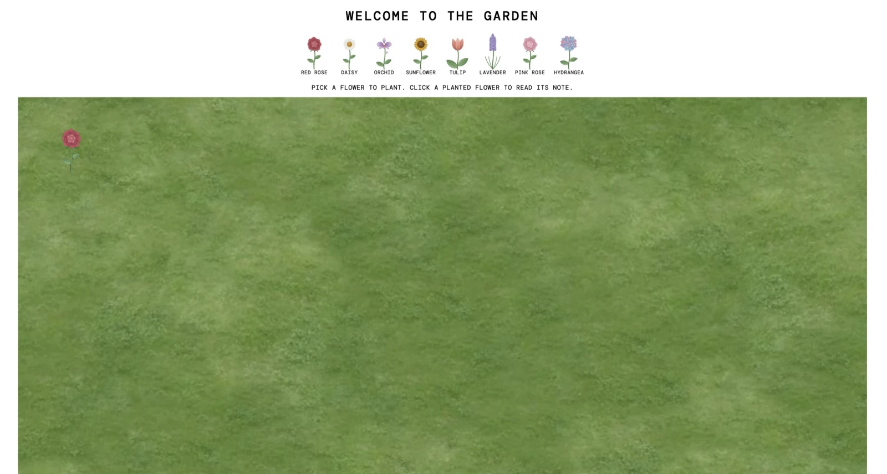

# The Garden 🌷

A shared online garden where you can sign up, plant a flower, leave a short message for everyone else to find, and dedicate a flower to someone you care about.

## Description

This is a full stack app I built to practice everything we've learned so far: a Node and Express server, a MongoDB database, EJS templates, and logging users in with Passport. Everyone who signs up can plant one of eight flowers with their name, a date, and a one line message. The garden only shows the flowers, so you have to click on a flower to read who planted it, when, and what they wrote. You can also dedicate a flower to someone by adding their email or phone number, and the app helps you send them a note about it. I also added a sign up and log in system so only logged in members can see the garden or plant anything.

## Screenshot



## Features

- Sign up, log in, and log out with an email and password
- Passwords are hashed with bcryptjs, so they are never stored as plain text
- Pick from 8 flowers: red rose, daisy, orchid, sunflower, tulip, lavender, pink rose, and hydrangea
- Add your name, a date, and a short one line message when you plant a flower
- Flowers line up in a grid on the grass as people plant them
- Name, date, and message stay hidden until you click a flower
- Dedicate a flower to someone by adding their email address or phone number (optional)
- After you plant a dedicated flower, a button opens your own email or messages app with a note already written to that person
- The email or phone number is private: other people only see "Dedicated to someone special", and only the person who planted the flower can see who it's for
- Edit a flower you planted (name, message, date, and who it's dedicated to)
- Remove a flower you planted
- Admin account that can remove any flower, to keep the garden friendly
- The server checks who is logged in on every request, so people can't edit or delete other people's flowers just by changing the page

## Tech Used

- HTML
- CSS
- JavaScript
- Node.js
- Express
- MongoDB with Mongoose
- EJS
- Passport (passport-local)
- bcryptjs
- express-session and connect-mongo

## How to Use

This app needs [Node.js](https://nodejs.org) and a MongoDB database.

1. Download or clone the project, then open the folder in your terminal.
2. Install the packages:
   ```
   npm install
   ```
3. Make your own `.env` file by copying `.env.example`, then fill in your own values:
   ```
   MONGO_URI=your MongoDB connection string
   SESSION_SECRET=any long random phrase
   ```
   The `.env` file is in `.gitignore` so my secrets don't go on GitHub.
4. Start the server:
   ```
   npm start
   ```
5. Open your browser and go to `localhost:8080`.
6. Click **Sign Up** and make an account.
7. Click a flower at the top, then type your name, a message, and pick a date. Click **Plant it**.
8. Optional: to dedicate the flower to someone, type their email address or phone number in the "Dedicate it to someone" box. After you plant it, click **Send an email** or **Send a text** to open your own email or messages app with a note ready to go. The note includes a link to the garden, so it will only work for them once the app is online and they have made an account.
9. Click any flower in the garden to read its message. If it's yours, you'll see **Edit** and **Remove** buttons.
10. To stop the server, press Ctrl + C in the terminal.

**Making an admin (optional):** sign up first, then run this with your email. There is no button for this on the website on purpose, so nobody can make themselves an admin.
```
node scripts/makeAdmin.js you@example.com
```

## How It Works

1. When you click a flower in the picker, `main.js` opens a form. When you submit it, `main.js` sends the flower type, your name, message, date, and the optional email or phone number to the server with `fetch`.
2. The server checks that you are logged in, then saves the flower in MongoDB. It also checks that the dedication is a real-looking email or phone number. It adds who planted it from your login, not from the form.
3. When the garden page loads, `main.js` asks the server for all the flowers and draws them in a grid. The server only sends the flower types at first.
4. When you click a flower, `main.js` asks the server for that one flower's name, date, and message and shows them in a popup. The server also says whether you're allowed to edit or delete it. It only sends the email or phone number back to the person who planted the flower, so nobody else can see it.
5. If the flower is dedicated to someone, the page builds a `mailto:` or `sms:` link. Clicking it opens your own email or messages app, so the message comes from you and the app doesn't need to send anything itself.

The routes follow the CRUD pattern from class:

| Action | Method | Route |
|---|---|---|
| Create a flower | POST | `/api/flowers` |
| Read all flowers | GET | `/api/flowers` |
| Read one flower | GET | `/api/flowers/:id` |
| Update a flower | PATCH | `/api/flowers/:id` |
| Delete a flower | DELETE | `/api/flowers/:id` |

## What I Learned

- How to set up login with Passport and keep people logged in with sessions
- How to hash passwords so they are stored safely
- How to keep secrets like my database link out of GitHub using a `.env` file
- How to use Mongoose models to set rules for my data, like only allowing 8 flower types
- Why the server has to check permissions and not just hide buttons on the page
- How to use `async/await` with `fetch` and with database calls
- How to build sprites out of SVG images and place them on a background
- How to keep private information, like an email or phone number, from being sent to the wrong people
- How to check input on the server, like making sure an email or phone number looks real
- How `mailto:` and `sms:` links work

VIEW APP HERE: https://thegarden-jhej.onrender.com

## Author

Maya Rose 🌹
